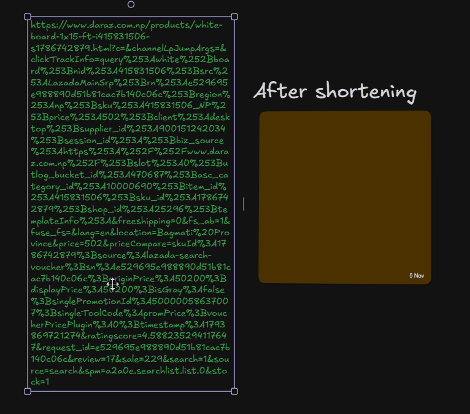
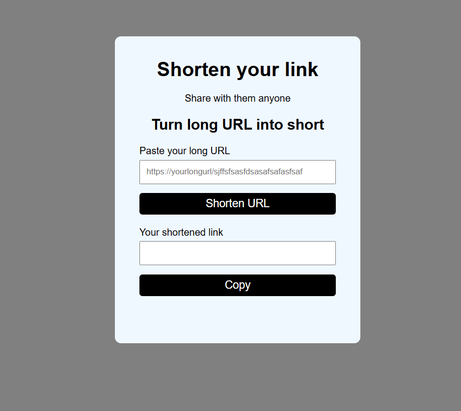

# URL-Shorterner
This is the site where you can make your very longgg url into short url and share with anyone you like.

here's an AWESOME gif of my project!
;

## HOW THIS WAS MADE
I made this because i personally feel the problem with big url that even feel weird to share with friends.and i thought to make one using by backend skill.

## What does it do 
it basically generate the short url from that big url which is easy to share to anyone with your friends .

## Tech stack
1. HTML
2. CSS
3. Javascript
4. Node js
5. Express js

## Demo Link
[Here is live demo of my project](https://url-shorterner-three.vercel.app/index.html)

### Development

1. Clone the repository:
```sh
git clone https://github.com/Saurav-Khanal/URL-Shorterner
```

2. Navigate to the project directory:
```sh
cd URL-Shorterner
```

3. Install dependencies:
```sh
npm install
```

4. Create a `.env` file and add your MongoDB connection string:
```env
MONGO_URI=your_mongodb_connection_string
```

5. Start the development server:
```sh
node local.js
```

6. Open your browser and visit:
```text
http://localhost:3000
```
## Screenshots
;

## Problem I Faced

during development everything was working fine on my local computer  but i got 
 some issues when deploying the project to Vercel.

i spent some time researching the problem and found that I had not configured my MongoDB connection string in vercel's environment variables. i added `MONGO_URI` there and made a few changes to my express application to make it work with vercel serverless environment.

after this changes making my proeject deploy without any isuue and working well.

## AI DISCLOUSURE
I used ai for the deployment debugging and to understand and resolve some unexpected error that i faced while building the project.

